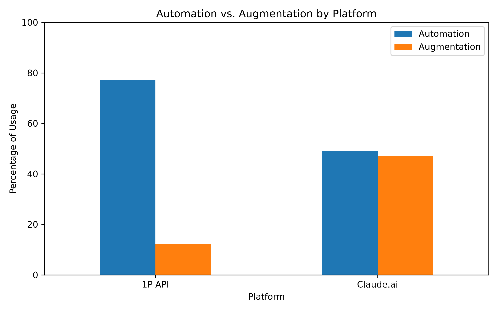
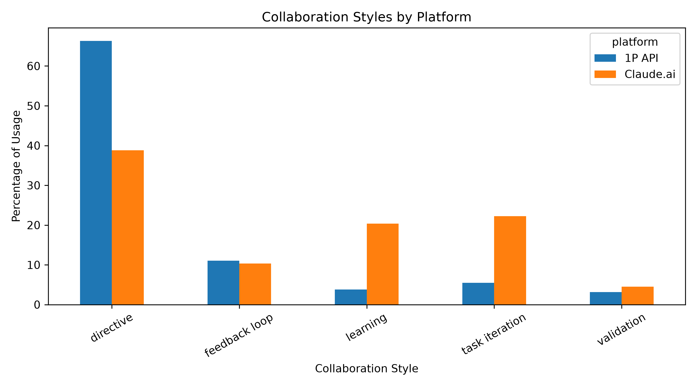
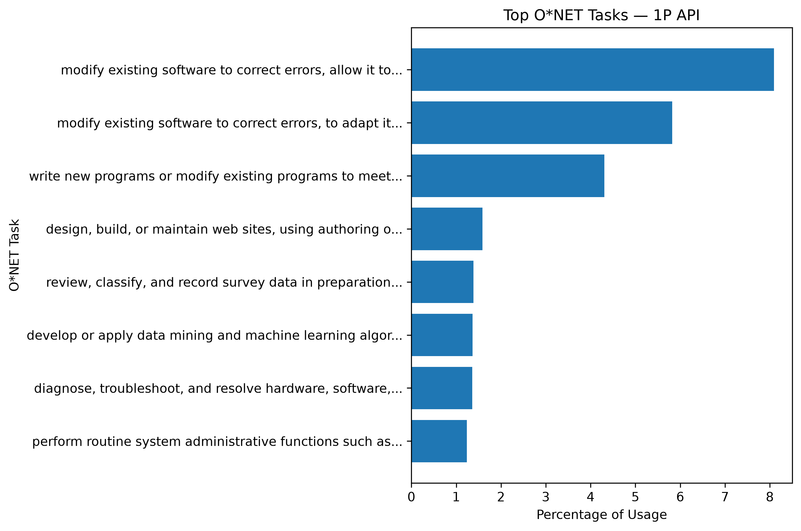
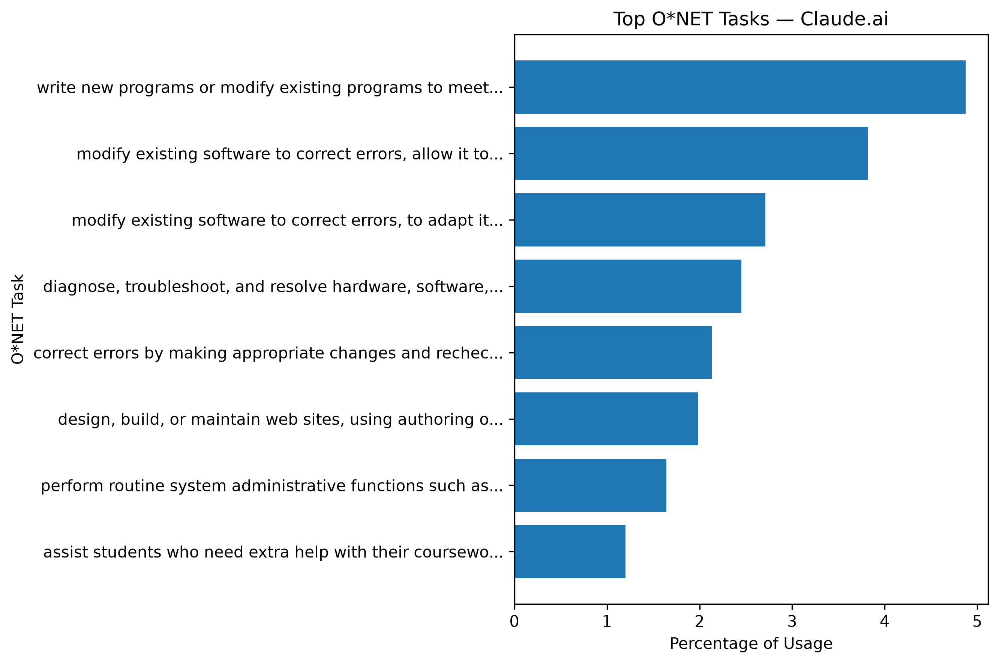
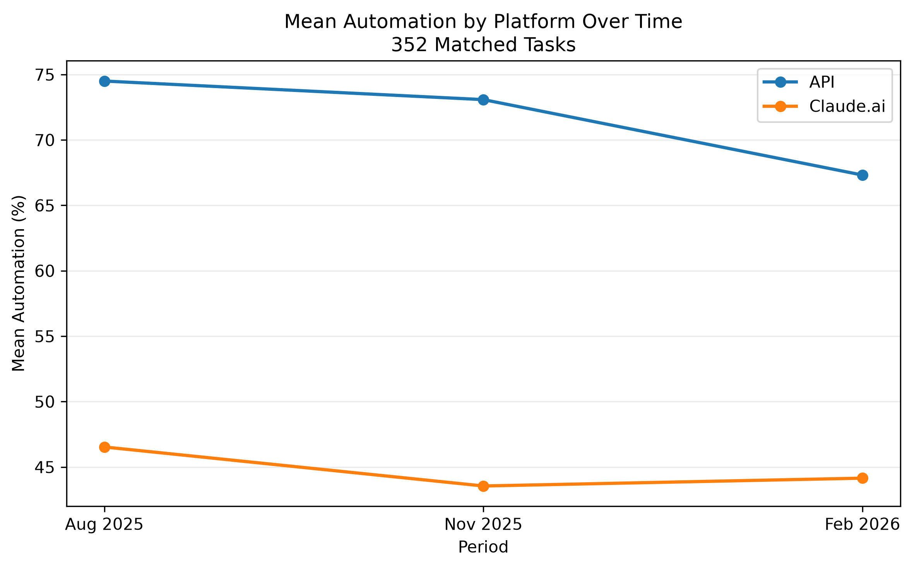
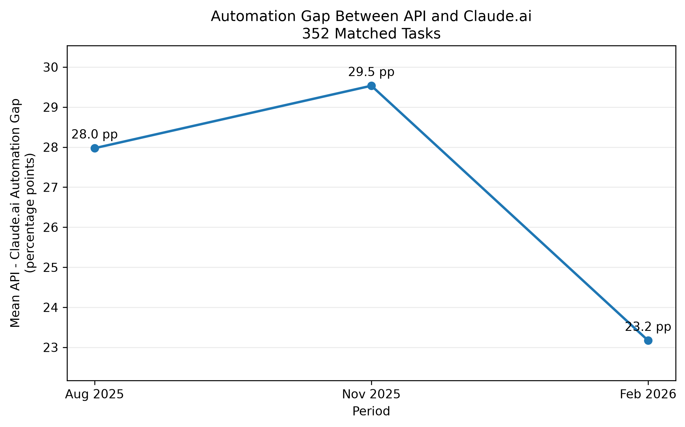
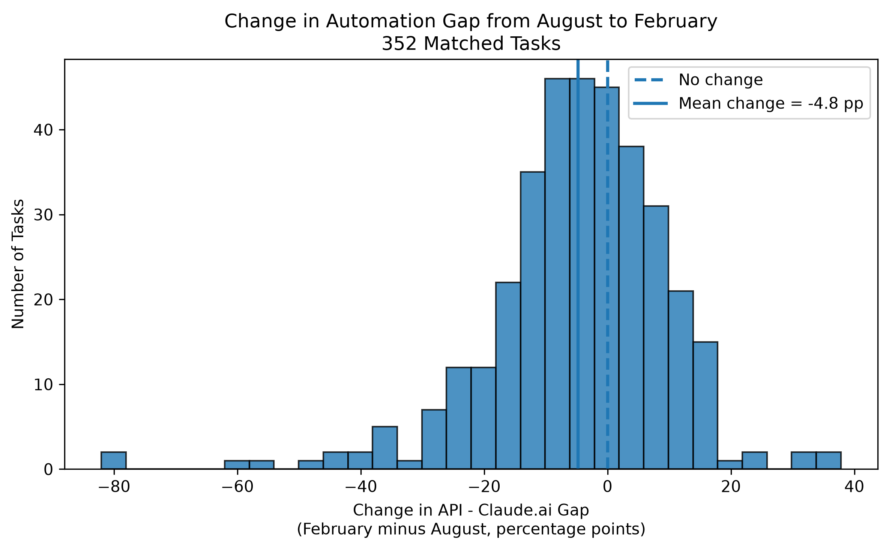

# Initial Data Profile: August 2025

## Anthropic Economic Index — September 2025 Release

This project uses the September 15, 2025 release of the Anthropic Economic
Index. The initial analysis focuses on data collected from August 4 through
August 11, 2025 for first-party API usage and Claude.ai Free and Pro usage.

The first-party API file contains 33,794 rows and the Claude.ai file contains
100,062 rows. Both files contain 10 columns describing the platform,
geography, analysis facet, category, and associated metric value. The released
data are aggregated statistics rather than individual conversations.

The primary variables for this project are the collaboration categories and
O*NET task categories because they allow comparison of how AI is used through 
the enterprise API and consumer-facing Claude.ai product.

## Automation and Augmentation

**Figure 1. Automation vs. augmentation by platform.** First-party API usage
is substantially more automation-oriented than Claude.ai usage. Automation
accounts for approximately 77.37% of API usage compared with 49.10% of
Claude.ai usage. Claude.ai has a much larger augmentation share, at
approximately 47.04%, compared with 12.41% for the API. Automation and
augmentation do not sum to 100% because the `none` and `not_classified`
categories are not included in either group.

## Collaboration Styles

**Figure 2. Individual collaboration styles by platform.** Directive usage is
the largest collaboration category for both platforms but is much more common
for the first-party API. Claude.ai shows considerably larger percentages for
learning and task iteration. These descriptive differences suggest that API
usage is more frequently characterized by task delegation, while Claude.ai
usage more often includes interactive assistance.

## O*NET Task Distribution

**Figure 3. Top classified O*NET tasks for first-party API usage.** The largest
API tasks are heavily concentrated in software-related activities, including
modifying software, programming, website development, machine learning, and
technical troubleshooting. The largest classified task accounts for
approximately 8.10% of API usage.

**Figure 4. Top classified O*NET tasks for Claude.ai usage.** Software-related
tasks are also prominent in Claude.ai usage. The largest classified task,
writing or modifying programs to meet customer requirements, accounts for
approximately 4.87% of usage. The top Claude.ai tasks are somewhat less
concentrated than the API tasks and also include an education-related task.

## Initial Observations

The preliminary profile shows a substantial descriptive difference in
collaboration style between the two platforms. First-party API usage has an
automation share approximately 28.27 percentage points higher than Claude.ai.
At the same time, software-related work is prominent on both platforms.

## Longitudinal Analysis Update

The initial analysis used the August 2025 release of the Anthropic Economic Index. The project was later expanded to include November 2025 and February 2026 in order to examine whether differences in automation-oriented usage between the API and Claude.ai changed over time.

For consistency across periods, the analysis focuses on O*NET tasks that appear on both platforms in all three periods. Automation-oriented usage is defined as the sum of the `directive` and `feedback loop` collaboration categories, consistent with the definition used in the earlier releases.

### Balanced Task Panel

A balanced panel was created by requiring each task to:

- appear on both API and Claude.ai,
- appear in August 2025, November 2025, and February 2026, and
- have at least 100 observations in every platform-period combination.

This produced a final balanced panel of **352 tasks**, with six observations per task (two platforms across three periods), for a total of **2,112 task-platform-period observations**.

Sensitivity analyses were also conducted using minimum-count thresholds of 50, 100, 250, 500, and 1,000. The overall pattern remained similar across these thresholds.

### Automation by Platform Over Time

Among the 352 matched tasks, mean automation percentages were:

| Period | API | Claude.ai |
|---|---:|---:|
| August 2025 | 74.50% | 46.53% |
| November 2025 | 73.08% | 43.55% |
| February 2026 | 67.32% | 44.15% |

API usage had a higher mean automation percentage than Claude.ai usage in all three periods.

### API–Claude.ai Automation Gap

The mean task-level automation gap was calculated as:

`API automation percentage - Claude.ai automation percentage`

The mean gaps were:

| Period | Mean Gap |
|---|---:|
| August 2025 | 27.97 percentage points |
| November 2025 | 29.53 percentage points |
| February 2026 | 23.17 percentage points |

The gap therefore did not decrease steadily. It increased slightly between August and November before becoming substantially smaller in February.

### Paired Task-Level Analysis

Because the same 352 tasks are observed in each period, changes in the API–Claude.ai gap were also analyzed at the task level.

From August 2025 to February 2026:

- the mean change in the gap was **-4.80 percentage points**,
- the median change was **-3.45 percentage points**,
- the 95% confidence interval for the mean change was **[-6.34, -3.27] percentage points**,
- **221 of 352 tasks (62.8%)** had a narrower gap,
- **131 of 352 tasks (37.2%)** had a wider gap.

A paired t-test found evidence that the mean August-to-February change differed from zero (`p < 0.001`). A Wilcoxon signed-rank test produced the same general conclusion (`p < 0.001`).

### Current Interpretation

The current results suggest that API usage remained more automation-oriented than Claude.ai usage for the same set of tasks across all three periods. However, the size of this difference changed over time.

The mean gap increased slightly from August to November 2025 and then narrowed substantially by February 2026. The August-to-February narrowing was observed across a majority of the matched tasks rather than being limited to only a few tasks.

These findings are descriptive and associational. API and Claude.ai represent different usage channels and should not be interpreted as verified identities of "business" and "consumer" users.

### Next Analysis

The next stage of the project will investigate what contributed to the narrowing of the automation gap. In particular, the analysis will examine whether changes were primarily driven by decreasing API automation, increasing Claude.ai automation, or both, and whether the changes differ across types of tasks or occupations.